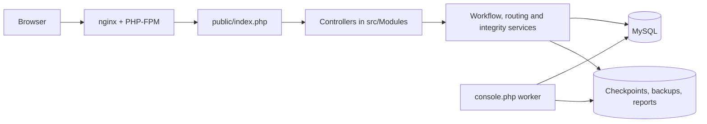

<a id="top"></a>

<h1 align="center">DepEd Iligan Document Tracking System</h1>

<p align="center">Tracks official documents through the DepEd Division of Iligan City, with a signed, hash-chained log of every step.</p>

<p align="center">
  
  
  
  
</p>

<p align="center"></p>

<p align="center">
  <a href="#about">About</a> · <a href="#screenshots">Screenshots</a> · <a href="#features">Features</a> · <a href="#tech-stack">Tech Stack</a> · <a href="#architecture">Architecture</a> · <a href="#getting-started">Getting Started</a> · <a href="#configuration">Configuration</a> · <a href="#usage">Usage</a> · <a href="#more">More</a>
</p>

---

## About

The DTS replaces the paper routing slip at the DepEd Division of Iligan City. A guest submits a document at the kiosk and gets a QR tracking slip, the Records Unit routes it, each department receives and signs off its step, and Records releases it. Every action is signed with the user's Ed25519 key and appended to a SHA-256 hash chain, so an edit made straight in the database is caught and the document is frozen. It is our thesis project. The active code is in `working-php/` (plain PHP 8.3, no framework); `backup-laravel/` holds the first Laravel 12 build for reference.

## Screenshots

<details>
<summary><b>Screenshots</b></summary>

<table>
<tr>
<td width="50%" align="center"><b>Guest submission</b><br><a href="working-php/documentation/screenshots/Guest%20Submission%20%28Filled%29.png"></a></td>
<td width="50%" align="center"><b>Guest submission success</b><br><a href="working-php/documentation/screenshots/Guest%20Submission%20Success.png"></a></td>
</tr>
<tr>
<td width="50%" align="center"><b>Document intake</b><br><a href="working-php/documentation/screenshots/Document%20Intake.png"></a></td>
<td width="50%" align="center"><b>Department tasks</b><br><a href="working-php/documentation/screenshots/Department%20Tasks.png"></a></td>
</tr>
<tr>
<td width="50%" align="center"><b>Digital signature</b><br><a href="working-php/documentation/screenshots/Department%20Digital%20Signature.png"></a></td>
<td width="50%" align="center"><b>Completed tasks</b><br><a href="working-php/documentation/screenshots/Department%20Completed%20Tasks.png"></a></td>
</tr>
<tr>
<td width="50%" align="center"><b>Document releasing</b><br><a href="working-php/documentation/screenshots/Document%20Releasing.png"></a></td>
<td width="50%" align="center"><b>All documents</b><br><a href="working-php/documentation/screenshots/Admin%20All%20Documents.png"></a></td>
</tr>
<tr>
<td width="50%" align="center"><b>Admin dashboard (dark mode)</b><br><a href="working-php/documentation/screenshots/Admin%20Dashboard%20%28Dark%20Mode%29.png"></a></td>
<td width="50%" align="center"><b>System overview</b><br><a href="working-php/documentation/screenshots/Admin%20System%20Overview.png"></a></td>
</tr>
<tr>
<td width="50%" align="center"><b>User management</b><br><a href="working-php/documentation/screenshots/Admin%20User%20Management.png"></a></td>
<td width="50%" align="center"><b>Statistics (officer)</b><br><a href="working-php/documentation/screenshots/Department%20Statistics%20%28Officer%29.png"></a></td>
</tr>
<tr>
<td width="50%" align="center"><b>Statistics (staff)</b><br><a href="working-php/documentation/screenshots/Department%20Statistics%20%28Staff%29.png"></a></td>
<td width="50%"></td>
</tr>
</table>

</details>

## Features

- Guests submit a document and get a printable slip with a QR code to track it.
- Records officers build each document's route, with suggestions learned from past routes.
- Departments receive, complete or decline their step, signing each action with a Security PIN.
- Anyone with the tracking code sees where a document is and who holds it.
- An edited log entry, signature or document status is detected before the next action, and the document is frozen.
- Admins get turnaround statistics, Excel and PDF reports, backups and an integrity check.
- Light and dark themes, keyboard and screen-reader support.

## Tech Stack

| Layer | Tools |
| :--- | :--- |
| Server | PHP 8.3, nginx + PHP-FPM, MySQL 8.0 |
| UI | Server-rendered PHP views, Tailwind CSS 3.4, plain JavaScript |
| Libraries | dompdf 3.1.6, chillerlan/php-qrcode 6.0.1, OpenSpout 5.3.0, Symfony Cache 7.4.14 |
| Crypto | libsodium (Ed25519, AES key wrap), Argon2id, SHA-256 |
| Tests | PHPUnit 12.5.42, Playwright (manual browser checks) |

## Architecture



Each request goes through one front controller to a module (Documents, Routing, Integrity, Users and so on); state changes run in one transaction in `DocumentWorkflowService`. The worker runs queued jobs and the scheduler: integrity checks, daily signed checkpoints, backups and metrics. How the hash chain and seals work: [CRYPTOGRAPHIC_LOGS_EXPLAINED.md](working-php/documentation/CRYPTOGRAPHIC_LOGS_EXPLAINED.md).

## Getting Started

Needs PHP 8.3 (with `sodium` and `pdo_mysql`), Composer, Node.js and MySQL 8.0.

```bash
cd working-php
npm install && npm run build && composer install
cp .env.example .env                 # then set DB_HOST, DB_DATABASE, DB_USERNAME, DB_PASSWORD
composer run seed:prod               # tables, departments, first accounts and keys
composer run dev                     # web server on https://localhost:8000, Tailwind watcher, queue worker
```

`database.sql` is only for a new, empty database; an existing one is upgraded with `scripts/migrations/master-migration.sql`. Before the system holds real documents, work through [SECURITY_BASELINES.md](working-php/documentation/SECURITY_BASELINES.md).

## Configuration

Every setting is listed in [`working-php/.env.example`](working-php/.env.example). The keys `seed:prod` writes, and the ones to set before going live, are explained in [SECURITY_BASELINES.md](working-php/documentation/SECURITY_BASELINES.md#1-secrets-in-env).

## Usage

1. A guest fills in the form at `/` and prints the tracking slip.
2. The Records Officer takes the document in on **Document Intake**, checks the suggested route and finalizes it.
3. Each department on the route receives the folder, completes its step and signs with its Security PIN.
4. The document comes back to Records and is released.
5. The guest scans the QR code or enters the tracking code to see each step.

Step-by-step guides per role: [Administrator](working-php/documentation/user_manuals/admin_manual.md), [Records Officer](working-php/documentation/user_manuals/officer_manual.md), [Department Staff](working-php/documentation/user_manuals/staff_manual.md). Sample output: [tracking form PDF](working-php/documentation/exports/document-tracking-form-DEPED-E5345FDA4F.pdf).

<details>
<summary><b>Default test accounts</b> (password: <code>password</code>, change it after the first sign-in)</summary>

| Role | Username |
| :--- | :--- |
| Administrator | `admin` |
| Records Officer | `records.unit` |
| Staff: Cash Unit | `cash.unit` |
| Staff: Admin Unit | `administrative.unit` |
| Staff: Personnel | `personnel.unit` |
| Staff: Supply Unit | `supply.unit` |
| Staff: Budget Unit | `budget.unit` |
| Staff: Accounting | `accounting.unit` |
| Staff: Legal Unit | `legal.unit` |
| Staff: Health & Nutrition | `health.and.nutrition` |
| Staff: BAC Unit | `bids.and.awards.committee.unit` |
| Staff: SDS Office | `schools.division.superintendent.office` |
| Staff: ASDS Office | `assistant.schools.division.superintendent.office` |
| Staff: CID | `curriculum.implementation.division` |
| Staff: SGOD | `school.governance.and.operations.division` |
| Staff: ICT Unit | `ict.unit` |

</details>

## More

<details>
<summary><b>Documentation</b></summary>

| File | What it covers |
| :--- | :--- |
| [OPERATIONS.md](working-php/documentation/OPERATIONS.md) | Seeders, every script, the worker as a service, log rotation, disk space, updating a server |
| [SECURITY_BASELINES.md](working-php/documentation/SECURITY_BASELINES.md) | Secrets, passwords and PINs, network, backups, off-server evidence, Content Security Policy |
| [CHAIN_SEAL.md](working-php/documentation/CHAIN_SEAL.md) | Entry and chain seals, sealing an existing database, the v1 to v2 upgrade |
| [TESTING.md](working-php/documentation/TESTING.md) | PHPUnit suites, one script per test class, thesis evidence runs, manual browser checks |
| [ACCESSIBILITY.md](working-php/documentation/ACCESSIBILITY.md) | Dialogs, menus, labels and focus handling |
| [CRYPTOGRAPHIC_LOGS_EXPLAINED.md](working-php/documentation/CRYPTOGRAPHIC_LOGS_EXPLAINED.md) | How the hash chain and signatures work |
| [HASH_VERIFICATION_LAYMAN_GUIDE.md](working-php/documentation/HASH_VERIFICATION_LAYMAN_GUIDE.md) | The same, without the jargon |
| [CACHING_AND_PJAX_EXPLAINED.md](working-php/documentation/CACHING_AND_PJAX_EXPLAINED.md) | Response cache and in-app navigation |
| [PITCH_AND_VALUE_PROPOSITION.md](working-php/documentation/PITCH_AND_VALUE_PROPOSITION.md) | Pitch per stakeholder |
| [CHANGELOG.md](CHANGELOG.md) | Changes per version |

</details>

<details>
<summary><b>Project structure</b></summary>

```
DTS-Prototype/
├── working-php/           active code (plain PHP 8.3)
│   ├── public/            front controller, CSS, JS, fonts
│   ├── src/               Modules, Common, Views, Research
│   ├── scripts/           seeders, migrations, worker and maintenance scripts
│   ├── tests/             PHPUnit suites
│   ├── deploy/ nginx/     systemd unit, logrotate and nginx config
│   ├── documentation/     manuals, guides, screenshots, test results
│   ├── console.php        background worker
│   └── database.sql       schema for a new database
└── backup-laravel/        original Laravel 12 build, kept for reference
```

</details>

<p align="right"><a href="#top">Back to top</a></p>
