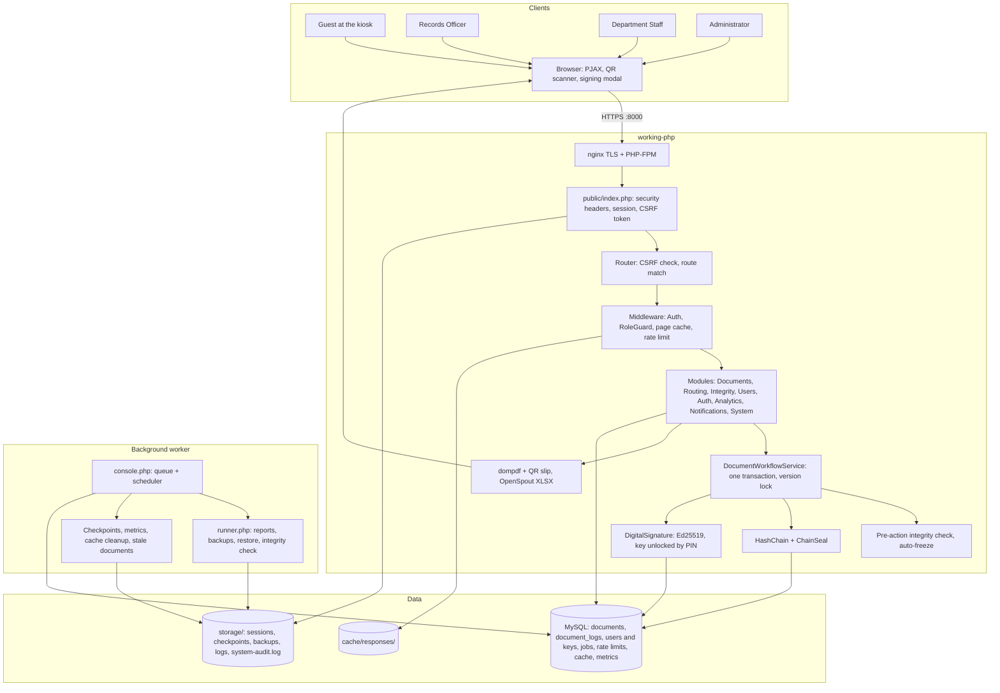
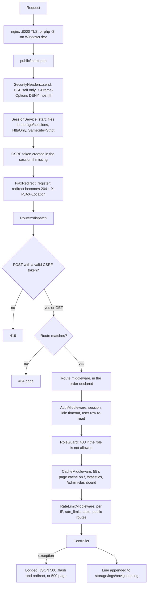
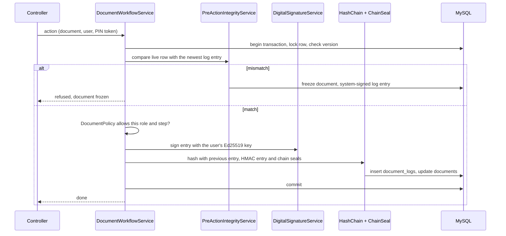
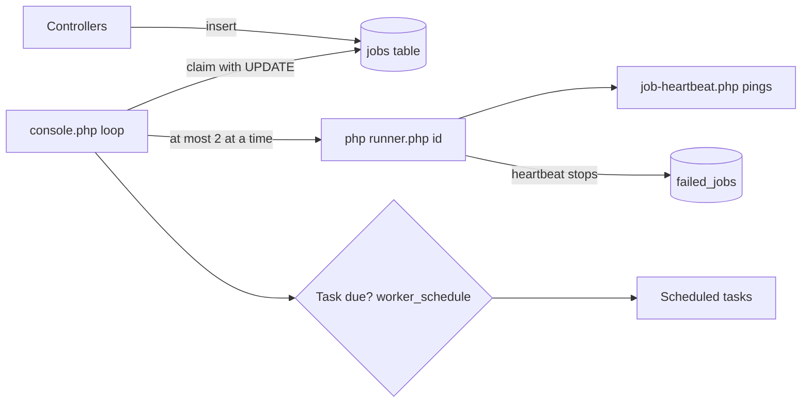
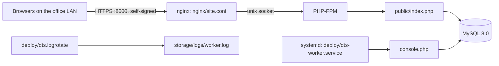

# Architecture

How the parts of `working-php/` fit together, from the browser to the database and the background worker. The README has the overview diagram; this page breaks it into its parts.

## 1. Overview

There is no framework. One front controller loads Composer's autoloader, registers about 80 routes and hands the request to `Router`. Nothing calls an outside service at runtime: no mail, no CDN, no remote API.

## 2. Request pipeline

- Each route lists only the middleware it needs. Public routes have no `AuthMiddleware`; signed-in routes have no rate limit.
- `AuthMiddleware` re-reads the user on every request, so deactivation, a role change or a new `session_version` applies at once. It blocks POSTs until the user has set a Security PIN.
- Rate limits (requests per 60 s per IP): submit 10, track 60, track module 120, track poll 240, PDF slip 10.
- Login and PIN attempts are throttled by `AttemptThrottleService` (table `attempt_throttles`), called from the controllers, not from middleware.

## 3. Modules

Code lives in `src/Modules/<Module>/`. Controllers handle HTTP; services hold the logic.

| Module | What it does | Main classes |
| :--- | :--- | :--- |
| Documents | Guest submission, intake, tasks, releasing, tracking, PDF slip | GuestController, IntakeController, TaskController, ReleasingController, DocumentWorkflowService, DocumentPolicy |
| Routing | Suggests a route from past routes for the same purpose | HeuristicRoutingService |
| Integrity | Hash chain, seals, signatures, checks | HashChainService, ChainSealService, ChainVerificationService, PreActionIntegrityService, DigitalSignatureService, IntegrityCheckJob, ChainCheckpointJob |
| Users | Accounts, Security PIN and keys, passwords | UserController, AccountController, SecurityKeyController, SecurityPinCacheService, PinConfirmationService |
| Auth | Sign-in, sign-out, password rules | AuthController, AttemptThrottleService, CredentialPolicy |
| Analytics | Dashboards, statistics, XLSX report | AdminDashboardController, StatisticsController, AdminAnalyticsService, DepartmentAnalyticsService, GenerateReportJob |
| Notifications | Bell, toasts, unread poll | NotificationController, NotificationService |
| System | Health page, backups, queue, scheduler, audit log | SystemHealthController, BackupManagerController, BackupService, QueueService, WorkerScheduleService, SystemAuditService |

The other folders in `src/`:

- `Common/`: router, middleware, session, security headers, config (reads `.env`), PDO connection, the database-backed query cache, rate limiting, `IntegrityKey` (HMAC under `APP_INTEGRITY_KEY`), validation and helpers.
- `Views/`: plain-PHP templates, split by role (`admin/`, `officer/`, `staff/`, `guest/`) plus shared layouts, components and error pages.
- `Research/`: the thesis evidence runners. Not loaded by the web app.

## 4. Document workflow and integrity

Every change to a document (submit, finalize intake, receive, complete, decline, release, freeze, unfreeze) goes through `DocumentWorkflowService`.

The user's private key is stored encrypted in `users.private_key`. It is unlocked with a key derived from the Security PIN (Argon2id). After one PIN entry, `SecurityPinCacheService` keeps an encrypted, session-bound token for `PIN_CACHE_DURATION`, so the next actions don't ask again. Signatures are checked with the public key that was active when the entry was signed (`user_public_key_histories`). How the chain and seals work: [CRYPTOGRAPHIC_LOGS_EXPLAINED.md](CRYPTOGRAPHIC_LOGS_EXPLAINED.md) and [CHAIN_SEAL.md](CHAIN_SEAL.md).

## 5. Worker and scheduler

`console.php` runs as one long process (a systemd service in production). Each loop it checks the scheduler, then claims at most one queued job.

Queued jobs: `GenerateReportJob`, `CreateBackupJob`, `RestoreBackupJob`, `IntegrityCheckJob`. The report job only counts rows; the XLSX is streamed when the user downloads it.

| Every | Task |
| :--- | :--- |
| 30 s | Move abandoned jobs to `failed_jobs` |
| 5 min | Sample database metrics, rebuild department metrics for the last two days |
| 1 h | Delete page-cache files older than 1 h, rename `navigation.log` past 50 MB, purge expired rate-limit and cache rows |
| 24 h | Signed chain-head checkpoint, metrics roll-up, remove pending documents older than 3 days |

The worker restarts itself after 100 jobs or 8 GB of memory, and refuses to start without `APP_INTEGRITY_KEY`. Running it as a service: [OPERATIONS.md](OPERATIONS.md#1-keep-the-queue-worker-running).

## 6. Data stores

MySQL tables by purpose:

| Purpose | Tables |
| :--- | :--- |
| Documents | `documents` (route as JSON, status, `version`, `chain_seal`), `purposes`, `departments` |
| Audit chain | `document_logs` (hash, previous hash, signature, seal, state hash, snapshot) |
| Users | `users`, `user_public_key_histories` |
| Queue | `jobs`, `failed_jobs`, `report_jobs`, `integrity_checks`, `worker_schedule` |
| Throttling | `rate_limits`, `attempt_throttles` |
| Cache | `cache`, `cache_locks` |
| Metrics | `daily_department_metrics`, `database_metrics` |
| Notifications | `notifications` |

Files:

| Path | Holds |
| :--- | :--- |
| `storage/sessions/` | PHP sessions |
| `storage/checkpoints/` | Daily signed chain-head checkpoints |
| `storage/app/backups/` | Zipped `mysqldump` backups (AES-256 when `BACKUP_PASSWORD` is set), kept `BACKUP_KEEP_DAYS` |
| `storage/logs/` | `navigation.log`, `worker.log`, `system-audit.log` (HMAC-chained) |
| `cache/responses/` | Full-page HTML cache |
| `cache/integrity-check-result.json` | Last integrity check result |

The three cache layers are explained in [CACHING_AND_PJAX_EXPLAINED.md](CACHING_AND_PJAX_EXPLAINED.md).

## 7. Roles

| Role | Signs in | Reaches |
| :--- | :--- | :--- |
| Guest | No | Submission form, success slip, tracking page and its API, printable slip (all rate limited) |
| Records Officer | Yes | Intake and route builder, finalize, decline, releasing, tasks, statistics and report |
| Department Staff | Yes | Tasks (receive, complete), QR scan, completed tasks, statistics, document view and hash chain |
| Administrator | Yes | Dashboard, all documents, system overview (integrity check, failed jobs, freeze all, database metrics), freeze and unfreeze, backups, user management |

Every signed-in role also has the Security PIN page, password change and notifications. `/dashboard` sends each role to its start page.

## 8. Frontend

- Pages are rendered on the server. `pjax-router.js` fetches the next page with an `X-PJAX` header and swaps `#pjax-content`, so the layout stays loaded.
- Scripts are split into `core/`, `layout/` (theme, notifications poll every 30 s, menus), `components/` (QR scanner, signing modal) and `pages/`.
- Chart.js, html5-qrcode and Sortable are vendored in `public/js/`. The CSP allows `'self'` only, so nothing loads from a CDN.
- Tailwind CSS 3.4 builds `input.css` into `public/css/tailwind.css` with `npm run build`.

## 9. Deployment

- `composer run dev` on Linux sets up nginx, PHP-FPM and the certificate, then starts the worker with a watchdog. On Windows it starts only `php -S 0.0.0.0:8000`.
- `composer run prod` sets up nginx and PHP-FPM but leaves the worker to systemd.
- Evidence leaves the server only by hand: copy `storage/checkpoints/`, `system-audit.log` and the backups off the machine. See [SECURITY_BASELINES.md](SECURITY_BASELINES.md#5-evidence-kept-off-the-server).

<a href="#top">Back to top</a>

